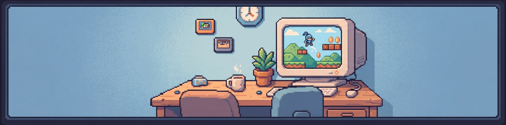
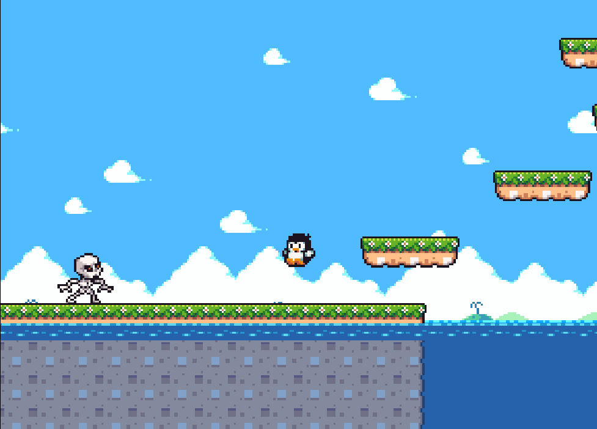
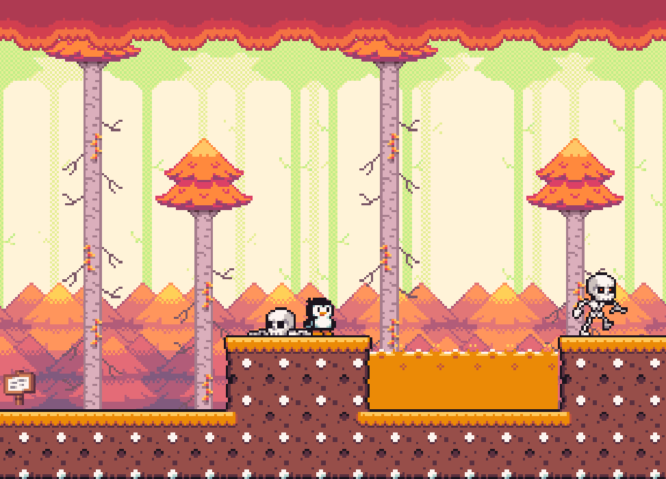
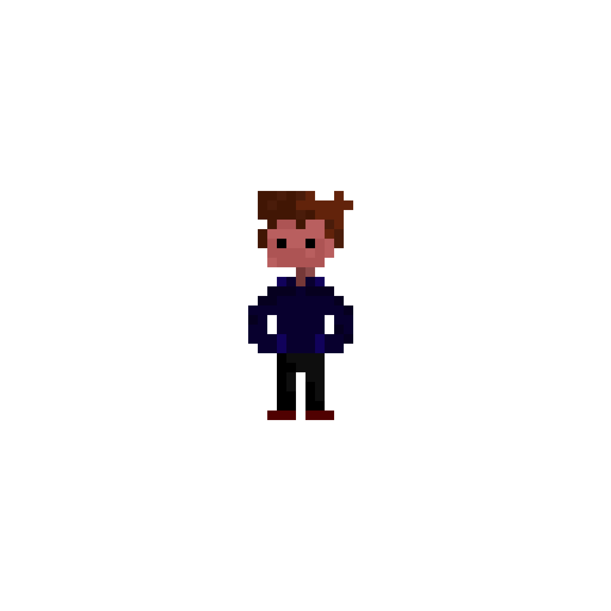

  

### Sou Estevão Figueiredo Garcia, estudante de Ciência da Computação. Gosto de desenvolver jogos e software.

Atualmente curso **Ciência da Computação** e estou construindo minha base como programador através de estudos, projetos pessoais e muita prática. Tenho interesse especial por **programação e desenvolvimento de jogos**.

Uso IA como ferramenta de aprendizado, mas o objetivo continua sendo desenvolver minha própria capacidade de programar.

Meu objetivo é construir uma base sólida em programação e desenvolver meus próprios jogos.

---

# 🛠️ Linguagens e ferramentas

**Estudando**

**Ferramentas**

**Desenvolvendo jogos**

---

## 🎮 Projeto em destaque

**[Teste de Jogo](https://github.com/Estevao-exe/meu-jogo)**: Esse jogo foi feito apenas para testar e saber como criar um jogo. Utilizei sprites de terceiros para a criação.

  
  

---

## 🎨 Pixel Art / Assets

Este projeto utiliza assets de pixel art disponibilizados publicamente por [GrafxKid](https://opengameart.org/users/grafxkid).

Os assets estão sob a licença **CC0 1.0 Universal (Public Domain Dedication)**, que permite usar, modificar e distribuir as obras. Termos: [Creative Commons — CC0 1.0 Universal](https://creativecommons.org/publicdomain/zero/1.0/).

**Créditos:** GrafxKid, pixel art assets (CC0 1.0).

---

## 🚀 Próximos softwares

- [x] Jogo de teste em Godot
- [ ] Meus próprios jogos

---

## 📫 Contato

  
  
  

---

  <strong>Imaginar → Tentar criar → Falhar → Tentar de novo → Resolver</strong>

  😁 Obrigado por visitar meu perfil!

