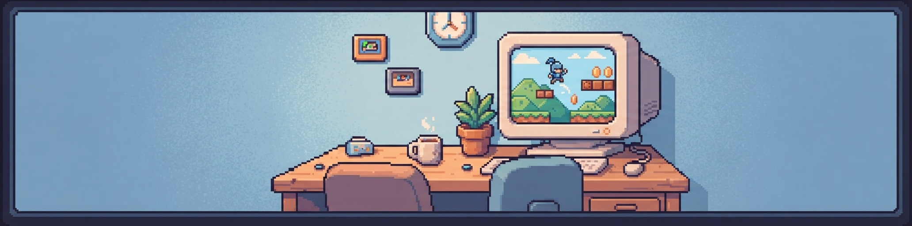
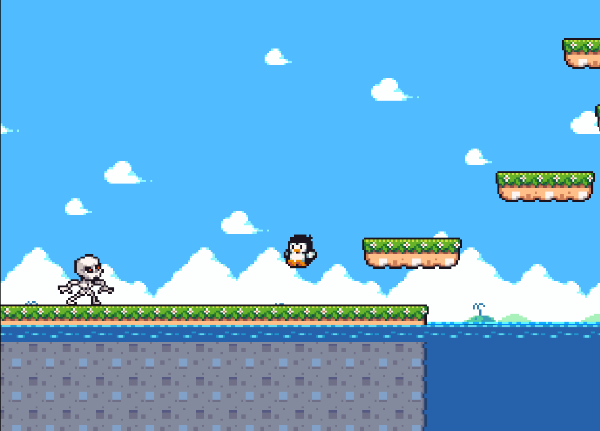
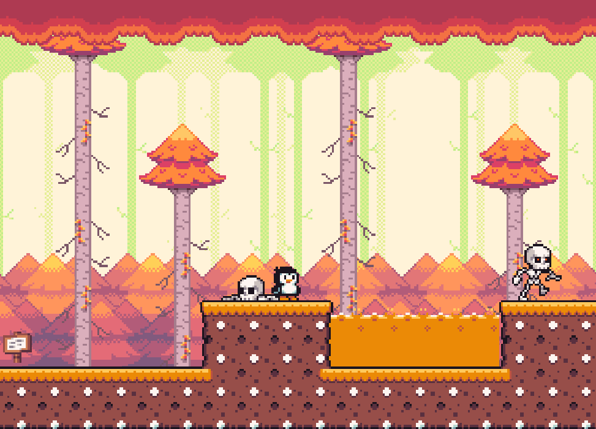
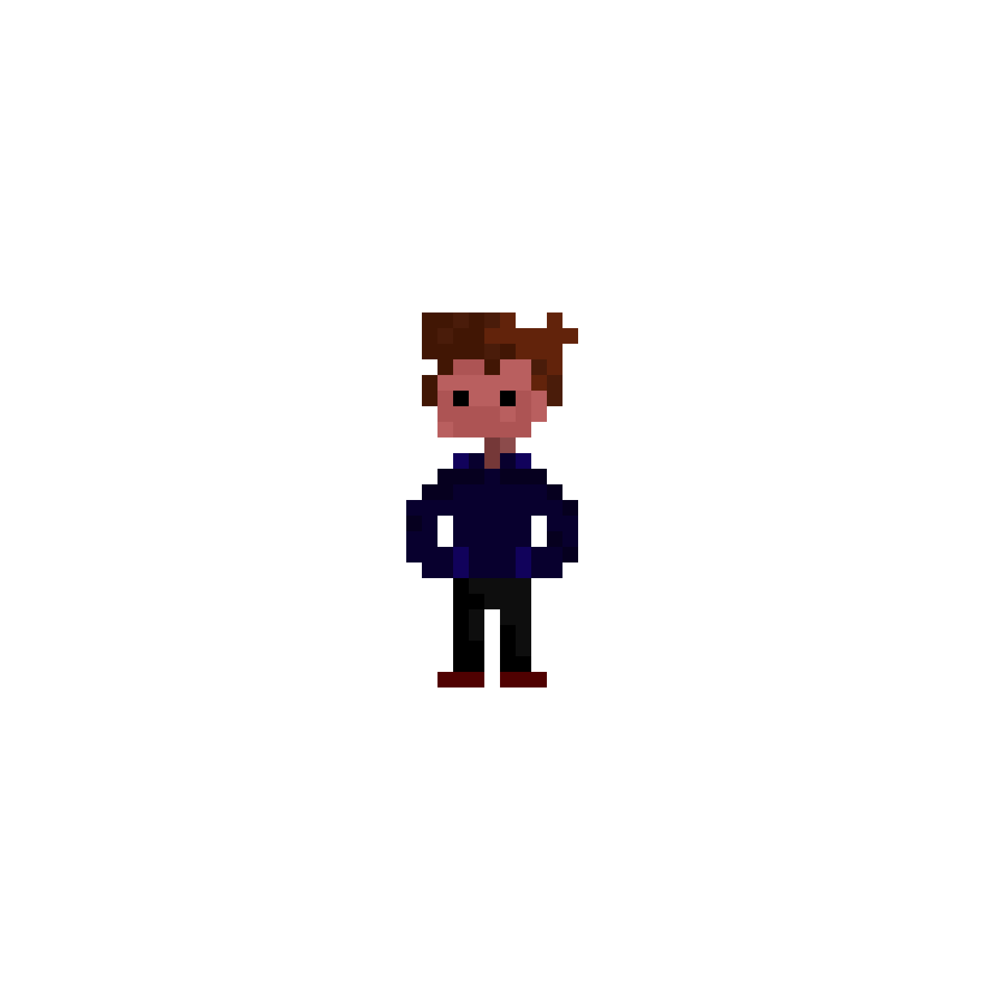

  

### Ola, sou Estevão Figueiredo Garcia 😎 Estudante de Ciência da Computação, gosto de desenvolvendo jogos e software.

Atualmente curso **Ciência da Computação** e estou construindo minha base como programador através de estudos, projetos pessoais e muita prática. Tenho interesse especial por **programação e desenvolvimento de jogos**.

Uso IA como ferramenta de aprendizado, mas o objetivo continua sendo desenvolver minha própria capacidade de programar.

---

# 🛠️ Linguagens e ferramentas

**Estudando**

**Ferramentas**

**Desenvolvendo jogos**

---

## 🎮 Projeto em destaque

**[Teste de Jogo](https://github.com/Estevao-exe/meu-jogo)**: Esse jogo foi feito apenas para testar e saber como criar um jogo. Utilizei sprites de terceiros para a criação.

  
  

<!-- Quando tiver o GIF da gameplay, suba em assets/gameplay.gif e tire os comentários da linha abaixo:

-->

<!-- Créditos dos sprites de terceiros: escreva aqui o autor e o link de cada pacote usado, por exemplo:
**Créditos:** sprites de [NOME DO AUTOR](LINK).
-->

---

## 🚀 Próximos softwares

- [x] Jogo de teste em Godot
- [ ] Meus próprios jogos
- [ ] Meus Softwares

---
## 📫 Contato

<!-- -->

  
  

---

  <strong>Imaginar → Tentar criar → Falhar → Tentar de novo → Resolver</strong>

  😁 Obrigado por visitar meu perfil!

